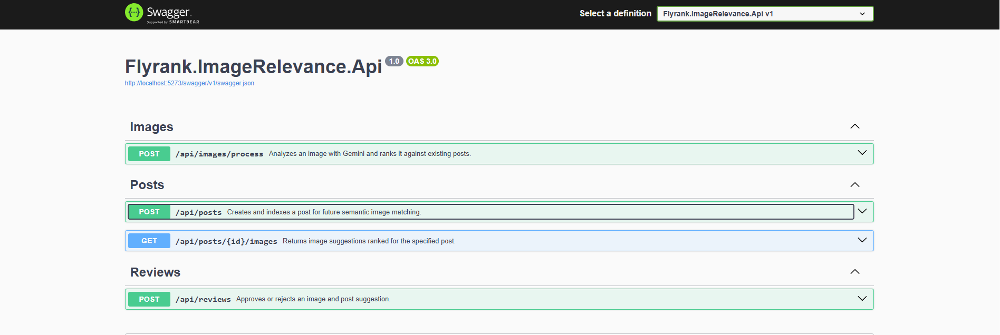
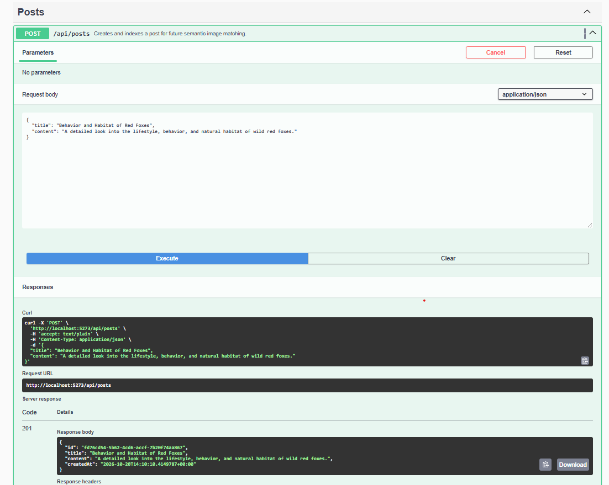
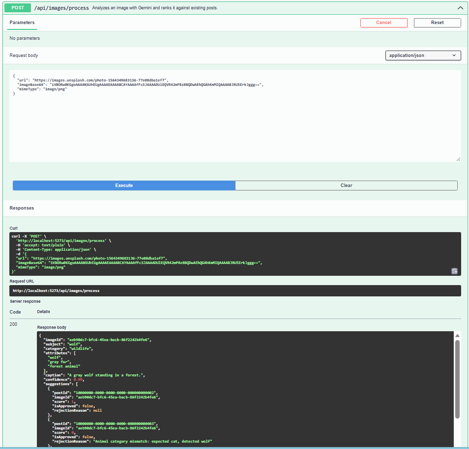

# Capstone Evidence

Screenshots are stored in [docs/images/](./docs/images/).

## Section 6 requirement mapping

| Requirement | Evidence | What it demonstrates | Status and limits |
| --- | --- | --- | --- |
| API routes and documented request surfaces |  | Swagger lists image processing, post creation, post image retrieval, and reviews. | Demonstrates the documented HTTP surface, not successful execution of every operation. |
| Post creation and response schema |  | A `POST /api/posts` request with the title `Behavior and Habitat of Red Foxes` and a `201` response containing the created post. | Supports successful post creation and the response shape. It is not a screenshot of invalid schema input. |
| Image processing and analysis response |  | A `POST /api/images/process` response identifies the sample as a wolf and returns ranked suggestions with scores and rejection details. | Supports single-image processing. The visible mismatch example in this capture is `expected cat, detected wolf`, not the fox-specific demo reason. |
| Structured analysis schema and validation | Implementation: `Flyrank.ImageRelevance.Api/Services/GeminiApiClient.cs` and `Flyrank.ImageRelevance.Api/Services/ImageRelevanceService.cs` | Gemini is asked for JSON with required fields, while the service validates the confidence range, tag count, and tag and caption lengths. The request validates HTTPS URL, MIME type, Base64, and image size. | Implemented in code. The attached screenshots do not show a deliberately invalid analysis being rejected. |
| Batch task image processing | No screenshot or implementation exists. | The current `POST /api/images/process` operation processes one image per request. | Not implemented. A queue, batch endpoint, or background job and its execution evidence are still required to satisfy this requirement. |
| Mismatch Guard rejection reason |  | The captured response includes an animal-category mismatch between the detected wolf and a different post subject. | Demonstrates a mismatch reason, but not the exact fox versus wolf text. The current Development demo flow in the HTTP file returns `Animal category mismatch: expected fox, detected wolf` when run against the newly created fox post. |

## Exact wolf versus fox demonstration

The screenshot set does not capture the exact fox-versus-wolf GET result. The reproducible request sequence is in [Flyrank.ImageRelevance.Api.http](./Flyrank.ImageRelevance.Api/Flyrank.ImageRelevance.Api.http). With Development demo mode enabled, run the requests in order. The response from `GET /api/posts/{id}/images` for the created fox post should contain:

```text
Animal category mismatch: expected fox, detected wolf
```

The following approval attempt should return `409 Conflict`. A reviewer may reject the same suggestion, which returns `200 OK`.
